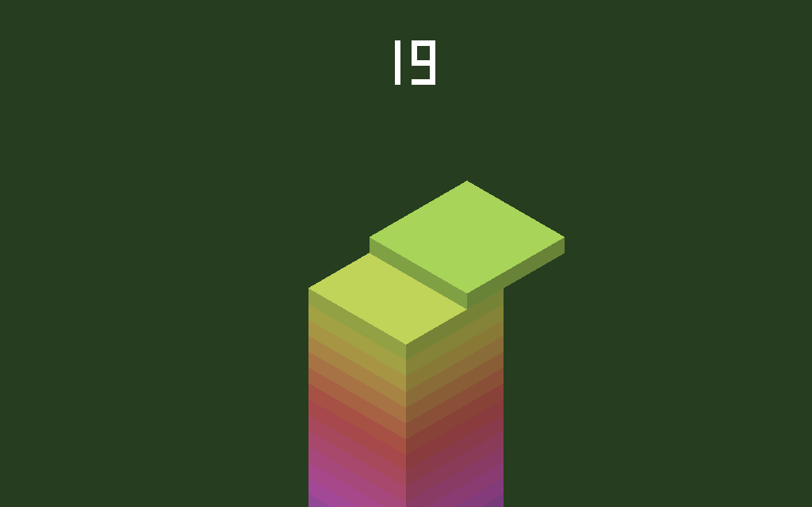

# Skyline

An original 3D block-stacking game, and Phoenix's showcase for **scene files with Unity-style
components and attached C# scripts**.

A slab slides back and forth over the tower. Tap (or click) to drop it. Whatever hangs over the
edge is cut off and tumbles away, and the tower narrows. Drop within a hair of perfect and the slab
snaps into place. Three perfect drops in a row grow the slab back. Miss completely and the run is
over: the camera pulls back to show your tower, and a tap starts again.



## How it's built

| File | Role | Godot / Unity equivalent |
|---|---|---|
| [`res/scenes/main.pscn`](res/scenes/main.pscn) | The scene: camera, sun, base pillar, the Game object | a `.tscn` scene file; a Unity scene's Hierarchy and Inspector |
| [`scripts/StackGame.cs`](scripts/StackGame.cs) | Gameplay, attached to `Game` | a `MonoBehaviour` on a GameObject |
| [`scripts/CameraRig.cs`](scripts/CameraRig.cs) | Follows the tower and tints the sky, attached to `Main Camera` | a camera script |
| [`scripts/ScoreHud.cs`](scripts/ScoreHud.cs) | A second script on `Game`: the score display | several components on one GameObject |
| [`scripts/StackRules.cs`](scripts/StackRules.cs) | The rules: plain C#, unit-tested in [`tests/`](tests/) | — |
| [`lib/main.cpp`](lib/main.cpp) | `runScene("res://scenes/main.pscn")` | the project's main scene |

The scene file uses Godot's text syntax and holds Unity-style GameObjects:

```ini
[node name="Game" parent="."]

[script class="Skyline.StackGame"]   ; attach a C# MetaBehaviour to "Game"
speed = 2.4                          ; read in Awake via properties.GetFloat("speed")
```

The scripts are Unity-shaped C#:

```csharp
public sealed class StackGame : MetaBehaviour
{
    protected override void Update()
    {
        if (Input.GetMouseButtonDown(0)) Drop(...);
        var slab = GameObject.Create("Slab");
        slab.AddComponent<MeshFilter>();                    // a cube
        slab.AddComponent<MeshRenderer>().color = Color.HSVToRGB(hue, 0.55f, 0.95f);
        slab.transform.localScale = new Vector3(w, 0.42f, d); // written in place in ECS memory
    }
}
```

At runtime:
- The C# scripts are compiled with NativeAOT into a native library. The engine calls into it
  directly, with no CLR hosting and no marshalling.
- `transform.localPosition` and `MeshRenderer.color` are references straight into the engine's
  ECS chunk memory.
- The engine renders the `MeshRenderer` cubes in 3D. The orthographic camera projects each lit
  face as a parallelogram, sorted back to front.

## Run it (desktop)

The C# scripts run on desktop. .NET can't target wasm64 NativeAOT yet, so they don't run on the
web.

1. Publish the scripts:

   ```bash
   dotnet publish scripts -c Release -r linux-x64 -o build/scripts   # win-x64 / osx-arm64
   ```

2. Build and run the app with them:

   ```bash
   PHOENIX_SCRIPT_MODULE=$PWD/build/scripts/Skyline.so phoenix run -d linux
   ```

   On Windows the library is `Skyline.dll`, and on macOS `Skyline.dylib`.

Headless, playing by itself and saving a screenshot (this is what CI runs):

```bash
SKYLINE_AUTOPLAY=1 build/linux/skyline --headless --frames=200000 \
    --script=$PWD/build/scripts/Skyline.so --screenshot=skyline.bmp
```

To run the rules' tests:

```bash
dotnet test tests
```
